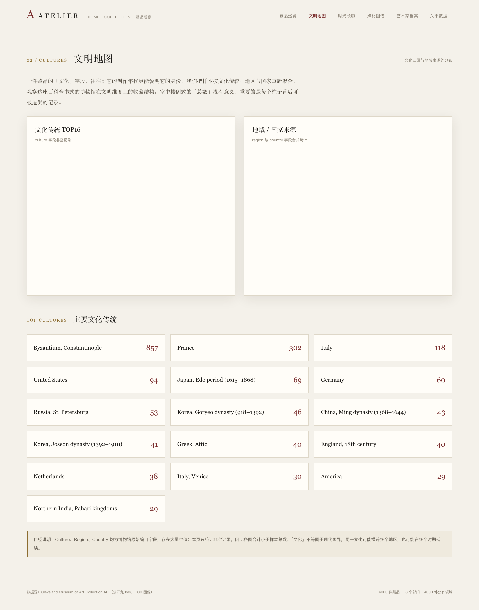
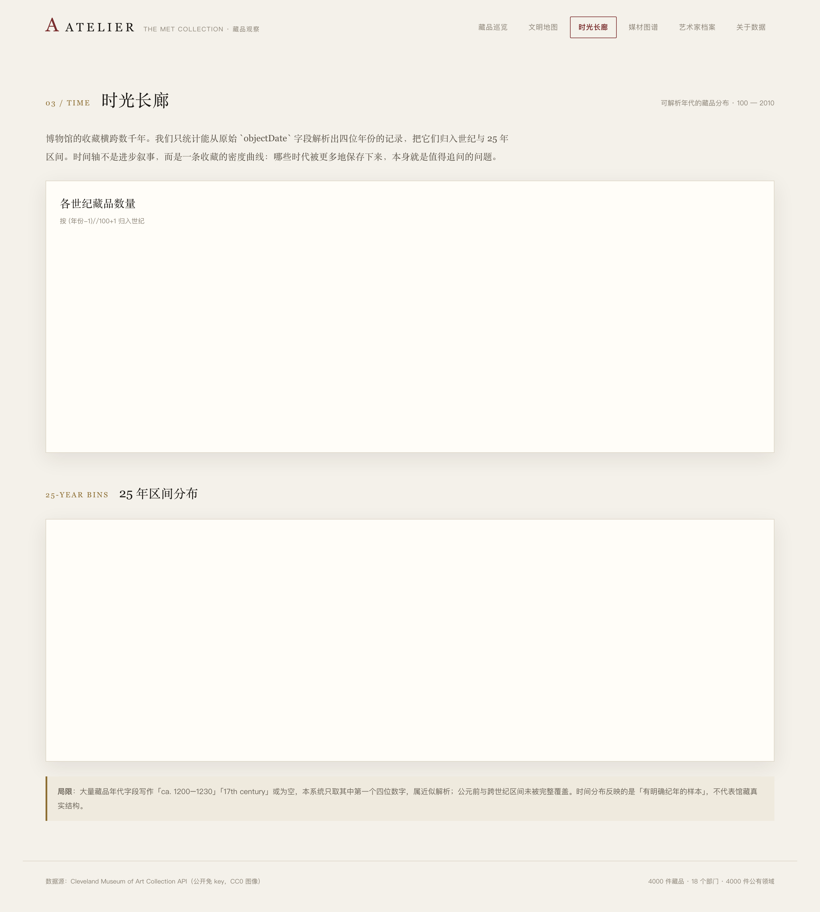
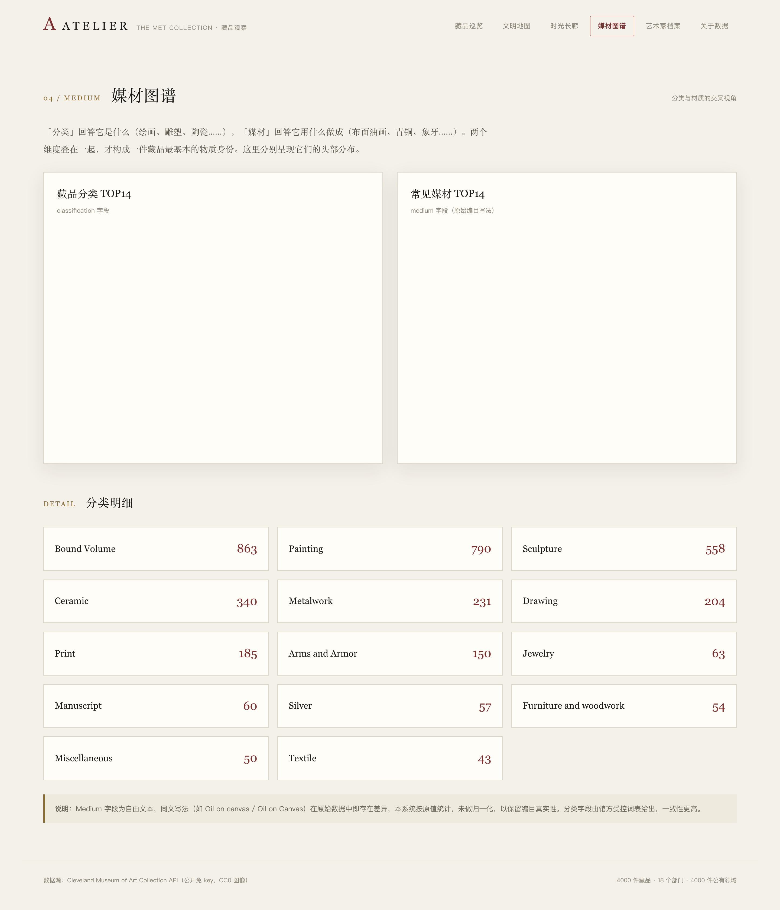
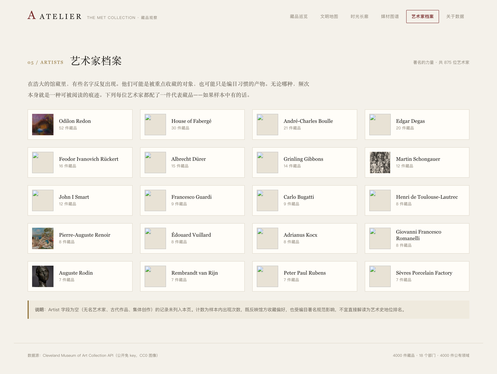
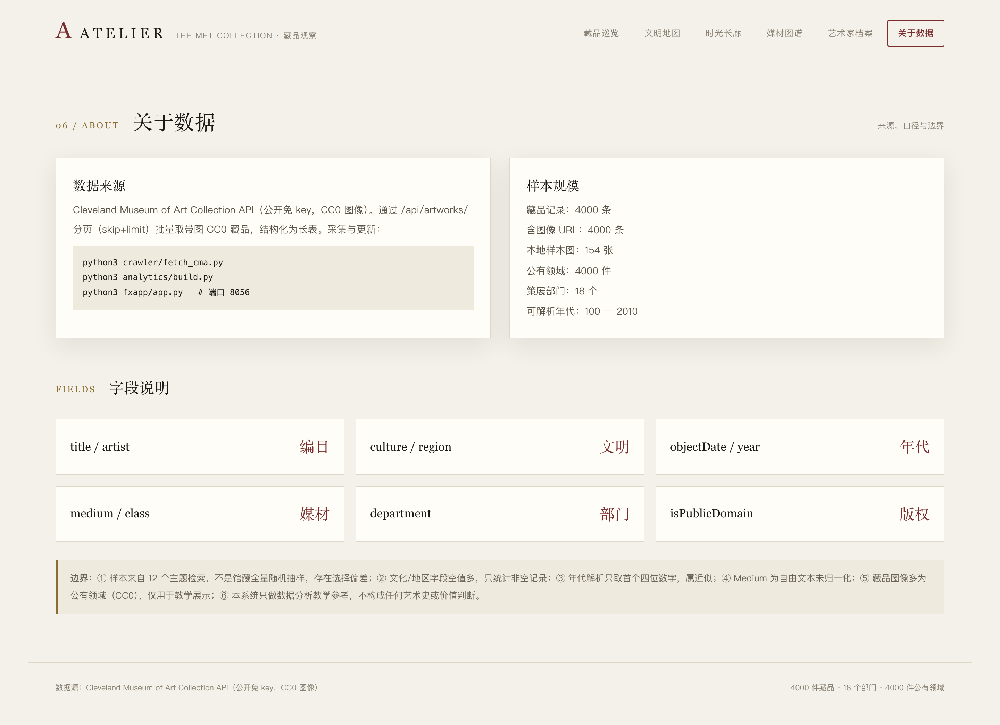

# 056 基于Cleveland Museum of Art公开数据的艺术品藏品分析系统-设计展示

> **代码有偿获取 可接受定制 微信联系方式: csbysj2020 或 ACE2487，备注(BS)**

> **完整源码与全套文档 · 在线自助获取 >>> [https://mbd.pub/o/bread/YZaWmJppaQ==](https://mbd.pub/o/bread/YZaWmJppaQ==)**

> **成品页（功能介绍 / 更多选题）>>> [https://bishe.suilang.net/products/art-gallery](https://bishe.suilang.net/products/art-gallery)**

> 

> 

## 视频

> **点击查看 >>> [https://www.bilibili.com/video/BV1TcyxzyENB/](https://www.bilibili.com/video/BV1TcyxzyENB/)**

## 项目简介

美术馆/画廊式视觉（暖白底、衬线大标题、图像优先卡片），刻意区别于数据看板与报纸式榜单。采集 Cleveland Museum of Art 公开 Collection API，按 12 主题检索带图藏品并结构化 4000 条记录（本地样本图 154 张），从文化传统、地域来源、年代分布、媒材分类与艺术家画像五个维度分析。Flask + Chart.js（本地化离线可用），6 个页面。样本来自主题检索非随机抽样、字段空值与年代近似解析均已如实标注，只做数据分析教学参考，不构成艺术史或价值判断。

大型博物馆的开放藏品目录为数据可视化教学提供了高质量素材。

本项目设计并实现了一套基于 Cleveland Museum of Art 公开数据的艺术品藏品分析系统：通过 Collection API 按 12 个主题检索带图藏品 ID，并发获取详情，结构化后入库 4000 条藏品记录（其中 4000 条含图像 URL，本地样本图 154 张），从文化传统、地域来源、世纪与年份分布、分类与媒材、艺术家频次五个维度构建藏品画像。

系统采用 Flask + Chart.js（本地化）与图像优先的画廊式界面（区别于常规数据看板），实现藏品巡览、文明地图、时光长廊、媒材图谱、艺术家档案、关于数据 6 个页面。

本仓库为**设计展示**：包含项目说明、技术架构、实验结果与运行截图；完整源码、任务书、开题报告、毕业论文与使用说明可通过上方链接自助获取，成品页可查看更多选题，也可联系微信咨询定制。

## 功能特性

1. 差异化视觉：美术馆/画廊式页面（图像网格、衬线大标题、大量留白），非通用看板/非报纸榜单

2. 真实采集：Cleveland Museum of Art Open Access API（公开免 key），12 主题检索带图藏品，4000 条记录

3. 图像本地化：154 张 CC0 样本图下载到本地，离线也能完整演示

4. 文明地图：文化传统与地域来源分布，只统计非空字段，不把缺失当零

5. 时光长廊：世纪柱状图 + 25 年区间折线，年代近似解析口径透明

6. 媒材图谱：分类（受控词表）与媒材（自由文本）分别统计，保留编目原貌

7. 艺术家档案：875 位署名艺术家频次与代表藏品，不解读为艺术史排名

8. 技术栈差异化：Flask + Chart.js（本地化），无 ORM，区别于 Django+ECharts/Plotly 系列

9. 合规边界：主题取样偏差与分析边界如实标注，不构成任何价值判断

## 技术架构

| 项目 | 说明 |
| --- | --- |
| 编程语言 | Python 3.8+ |
| Web 框架 | Flask（轻量路由，无 ORM） |
| 图表 | Chart.js（本地化离线可用） |
| 数据源 | Cleveland Museum of Art Open Access API（公开免 key） |
| 样本规模 | 4000 藏品 / 18 部门 / 154 本地图 |
| 运行端口 | http://127.0.0.1:8056 |
| 说明 | 数据直读 analysis JSON，无需数据库 |

## 目录结构

以下为完整交付版的结构（本仓库仅作设计展示）：

```
art-gallery/
├── analytics/
│   └── build.py
├── crawler/
│   ├── download_images.py
│   └── fetch_cma.py
├── data/
│   ├── analysis/
│   │   ├── artists.json
│   │   ├── centuries.json
│   │   ├── classes.json
│   │   ├── cultures.json
│   │   ├── departments.json
│   │   ├── gallery.json
│   │   ├── mediums.json
│   │   ├── regions.json
│   │   └── timeline.json
│   ├── processed/
│   │   └── objects.csv
│   └── stats.json
├── fxapp/
│   └── app.py
├── static/
│   ├── css/
│   │   └── style.css
│   ├── images/
│   │   ├── 100136.jpg
│   │   ├── 100182.jpg
│   │   ├── 100489.jpg
│   │   ├── 100824.jpg
│   │   ├── 101264.jpg
│   │   ├── 101271.jpg
│   │   ├── 101355.jpg
│   │   ├── 101356.jpg
│   │   ├── 101358.jpg
│   │   ├── 101360.jpg
│   │   ├── 101361.jpg
│   │   ├── 101362.jpg
│   │   ├── 101363.jpg
│   │   ├── 101376.jpg
│   │   ├── 101378.jpg
│   │   ├── 101386.jpg
│   │   ├── 101389.jpg
│   │   └── …
│   └── …
└── …
```

## 数据与实验结论

- 实验显示样本覆盖 18 个策展部门、875 位署名艺术家，公有领域藏品 4000 件。
- 真实采集：Cleveland Museum of Art Open Access API（公开免 key），12 主题检索带图藏品，4000 条记录
- 图像本地化：154 张 CC0 样本图下载到本地，离线也能完整演示
- 时光长廊：世纪柱状图 + 25 年区间折线，年代近似解析口径透明

## 交付内容

1. 完整源码（Flask 应用 + 采集器 + 分析引擎 + 6 页面）
2. 真实数据（objects.csv + analysis JSON + 本地样本图）
3. 任务书与开题报告（Word）
4. 毕业论文（Word 七章制）
5. 二次开发说明（Word+md）
6. 6 张截图 + 封面 + 演示视频

## 常见问题

**为什么视觉风格和其他成品差这么多？**

刻意设计：本成品用图像优先的画廊式页面（衬线大标题、暖白底、留白）替代通用数据看板，是差异化探索。

**样本是随机抽样的吗？**

不是。来自 12 个主题的带图检索，存在选择偏差，页面与论文均已如实说明。

**年代数据准吗？**

objectDate 多为自由文本（约年、跨世纪），本系统只取首个四位数字，属近似解析，页面有口径说明。

**文化字段为什么很多空？**

馆方原始编目即如此，本系统只统计非空记录，不把缺失当作零。

**图像能离线看吗？**

能。CC0 样本图已下载到本地 static/images/，Chart.js 也已本地化，断网可完整演示。

## 截图







